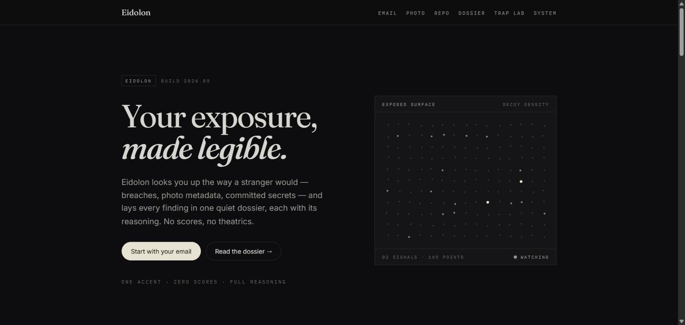
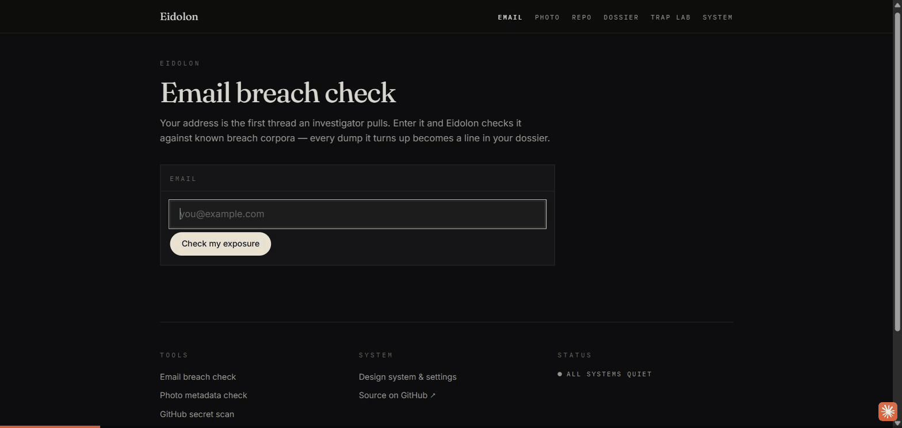

# Eidolon

[](https://github.com/Ayaan1911/Eidolon/actions/workflows/ci.yml)
[](LICENSE)


> Eidolon answers one question: what can someone discover about you without you realizing it?



## Contents

- [What it does](#what-it-does)
- [Status](#status)
- [Structure](#structure)
- [Running locally](#running-locally)

## What it does

Eidolon works in two movements.

**The Mirror** shows you your own exposure — the same footprint an attacker would find:

- **Breach & password exposure** — checks an email against known breaches and scores password strength
- **Photo metadata** — pulls EXIF/GPS data out of a photo to show what it leaks about where it was taken
- **Repo secret scanning** — scans a GitHub user's public repos for committed secrets

Every check lands in one running dossier, and every finding comes with a reasoning panel
explaining why it matters — no numeric exposure score. That's deliberate: a single number invites
false confidence, so Eidolon sticks to narrative findings with full reasoning instead.



**The Trap** plants deception tied to what the Mirror finds, so if someone acts on that exposure, you
know. Right now that's one working trap type: a decoy API key (`eidolon_live_...`) that's
self-verifying via an HMAC signature — no database required — and posts an ntfy alert with the
requester's IP and rough geolocation the moment it's used. Other trap types (tied directly to
Mirror findings) aren't built yet.

## Status

- **Mirror** — complete: all three checks above are built and working end to end.
- **Trap** — in progress:
  - [x] Honeytoken (self-verifying decoy API key, ntfy alert)
  - [x] Wire honeytoken generation into Mirror dossier findings

`legacy/` holds the previous implementation for reference only — it isn't part of the build.

## Structure

- `backend/` — FastAPI service (exposure checks + trap endpoints)
- `frontend/` — React + Vite + Tailwind UI

## Running locally

```bash
# backend
cd backend
python -m venv .venv && source .venv/Scripts/activate
pip install -r requirements.txt   # runtime dependencies, pinned to exact versions
uvicorn main:app --reload --port 8001

# frontend
cd frontend
npm install
npm run dev
```

## Running tests

```bash
# backend (from backend/, with the venv active)
pip install -r requirements-dev.txt   # requirements.txt plus pytest, pytest-cov, pytest-randomly, ruff
python -m pytest

# frontend
cd frontend
npm run lint
npm run build
```

Tests need no secrets or network: `backend/conftest.py` supplies dummy environment values,
a fresh in-memory database per test, and stubs for external services. The same checks run in
GitHub Actions on every push and pull request.

Python: the repo does not pin a version (Render's is set in its dashboard). The pinned
versions were tested on Python 3.11, which CI also uses.


## Deploying: the client IP behind a proxy

Rate limits and trap alerts need the visitor's real IP. On Render, a proxy sits in front of the
app, so the app has to decide whose word to take. `X-Forwarded-For` can be written by anyone.

- **Start command.** In the Render dashboard set it to:
  `uvicorn main:app --host 0.0.0.0 --port $PORT --no-proxy-headers`
  The old command (`--proxy-headers --forwarded-allow-ips=*`) makes uvicorn trust the header from
  any sender and rewrite `request.client.host` itself, using the leftmost entry, which a visitor can
  forge. Until it is changed, the app only sees that spoofable address; the code below cannot fix it,
  because the rewrite happens before the app runs.
- **`TRUSTED_PROXY_HOPS`** (default `0`) is how many proxies sit in front of the app. With `0` the
  header is ignored and the socket address is used. With `N`, the app reads `X-Forwarded-For` from the
  right and takes the Nth entry from the end (never the leftmost), and falls back to the socket address
  if the header is short or not an IP.
- **Finding the right value.** Log in as admin, open the System page, and use "Client IP check" from your
  own network. Compare "Resolved IP" with your real public IP (search "what is my IP"). Try
  `TRUSTED_PROXY_HOPS=1` first; if "Resolved IP" is a Render/Cloudflare address instead of yours, try `2`.
  Pick the smallest value where it shows your own IP.


## Secrets

The backend refuses to start unless `ADMIN_KEY` (at least 12 characters) and `HONEYTOKEN_SECRET`
(at least 16) are set to real values, not blank and not the `CHANGE_ME...` placeholders from
`backend/.env.example`. The error names the variable and its length, never its value. Generate them:

```bash
python -c "import secrets; print(secrets.token_hex(32))"   # HONEYTOKEN_SECRET
python -c "import secrets; print(secrets.token_urlsafe(24))"   # ADMIN_KEY (the passphrase you log in with)
```

Set both in the Render dashboard (and in a local `backend/.env`, which is not committed). For local
development only, `EIDOLON_ENV=dev` skips the check; never set it on Render.
