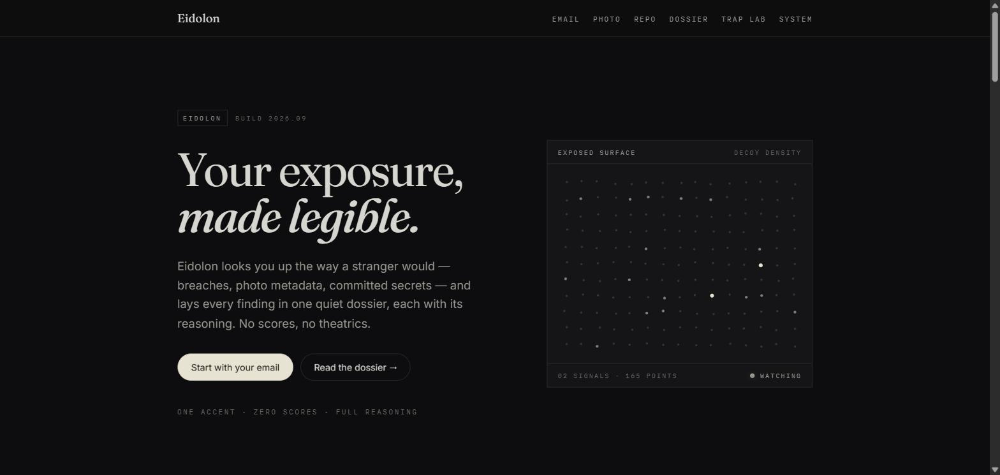
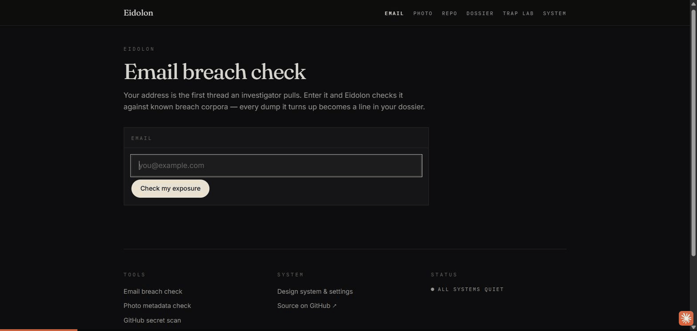
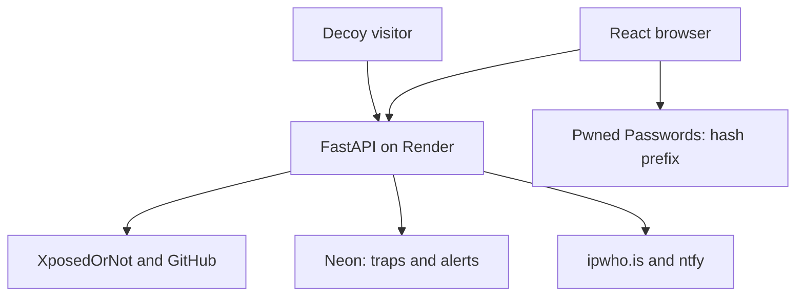

# Eidolon

[](https://github.com/Ayaan1911/Eidolon/actions/workflows/ci.yml)
[](LICENSE)


> See what your public footprint reveals, understand each finding, and place decoys to observe later contact.

[Open the app](https://eidolon-khaki.vercel.app/) · [API health](https://eidolon-2515.onrender.com/health) · [Threat model](docs/security/threat-model.md) · [Recovery procedure](docs/operations/database-recovery.md)



## What works

| Feature | Current behavior |
|---|---|
| Email exposure | Checks an email through XposedOrNot and explains returned breach information. The provider receives the full email. |
| Password exposure | Hashes the password in the browser, sends only the first five SHA-1 hex characters to Pwned Passwords, and compares suffixes locally. A standalone check; it does not add a dossier finding. |
| Photo metadata | Extracts EXIF and valid GPS coordinates from an uploaded image. The backend processes the photo without an application-level persistent image store. |
| Repository scanning | Checks selected files on the default branches of a GitHub user's public, non-fork repositories for six secret patterns. Masks matches and reports partial coverage. |
| Dossier | Collects email, photo and repository findings with explanations and actions. State survives page navigation, but resets on browser reload. |
| Trap pages | An authenticated admin creates standalone or finding-linked decoy login URLs. Visits and form attempts are stored in Postgres and appear in Trap Lab on refresh. |
| Decoy API keys | An admin mints HMAC-signed decoy keys, optionally linked to a finding. Valid decoy use schedules a best-effort ntfy notification; the public verifier always answers `401`. These events are not stored in the Trap Lab database. |

Decoys must be placed manually in systems you control. Eidolon does not edit repositories, rotate leaked credentials, identify a person from an IP, or continuously monitor accounts. Detection and deception are implemented; the remaining release work is tracked in [notes.md](notes.md).



## Try the public demo

1. Open **Repo**, enter your own GitHub username, and run a scan.
2. Read any coverage warning before interpreting the findings. A capped scan is incomplete even when it finds no secrets.
3. Open **Dossier** and a finding's reasoning panel. A `Contained` informational warning is not a claim that the account is safe.
4. Open **Trap Lab** to explore demo mode. Real trap creation and stored alerts require the owner's admin login.

For the photo check, use an image you are comfortable uploading. Never enter real credentials into a decoy login form. Opening a real trap URL records a visit and may send a notification, so use a local instance for experiments.

## Architecture and data

`frontend/` is a React/Vite/Tailwind application; `backend/` is a FastAPI service using SQLAlchemy and Alembic. Production uses Vercel, Render and Neon Postgres. Local development can use SQLite.



| Data | Destination and lifetime |
|---|---|
| Password check | Plaintext and full hash stay in browser code; Pwned Passwords receives a five-character hash prefix and normal connection metadata. |
| Email check | Full email goes through the backend to XposedOrNot. Results go to browser memory; provider breach metadata is cached in server memory. |
| Photo | Image goes to the backend; EXIF/GPS comes back to browser memory. Multipart handling may use temporary spool files. No persistent image store is implemented. |
| Repository check | GitHub receives the queried username and repository requests. Findings are returned masked and live in browser memory. Finding-linked traps store repository/file context. |
| Trap visit/form | Postgres stores IP, time, reported browser/device, referrer, enrichment and any typed username/email. Only password presence/length is sent by the decoy form, never its password contents. |
| Enrichment/push | Visitor IP goes to ipwho.is; ntfy receives an alert with IP and request/context details. Anyone knowing the current public ntfy topic can read or publish to it. |
| Admin session | A bearer token is stored in browser localStorage for up to 24 hours. Logout removes the browser copy; rotating either server secret invalidates all sessions. |

See the [threat model](docs/security/threat-model.md) for trust boundaries, controls and residual risks. Hosting providers may maintain their own logs and retention policies.

## Run locally on Windows

Use Python 3.11 and Node.js 22 with npm. CI also tests Python 3.14. Render's Blueprint pins Python 3.11.9. Commands below run from the repository root and explicitly isolate development from any existing `backend/.env`.

In PowerShell, create the environment if it does not already exist, then install dependencies:

```powershell
cd D:\Projects\Eidolon
if (-not (Test-Path .venv\Scripts\python.exe)) { py -3.11 -m venv .venv }
.\.venv\Scripts\python.exe -m pip install -r backend\requirements-dev.txt

$env:PYTHON_DOTENV_DISABLED = "1"
$env:EIDOLON_ENV = "dev"
$env:DATABASE_URL = "sqlite:///eidolon.db"
$env:ADMIN_KEY = "local-demo-admin-only"
$env:HONEYTOKEN_SECRET = "local-demo-signing-secret-only"
$env:PUBLIC_BASE_URL = "http://localhost:8001"
$env:NTFY_TOPIC = ""
$env:GITHUB_TOKEN = ""
$env:TRUSTED_PROXY_HOPS = "0"
Remove-Item Env:RENDER -ErrorAction SilentlyContinue
Remove-Item Env:EIDOLON_TEST_DATABASE_URL -ErrorAction SilentlyContinue

cd backend
..\.venv\Scripts\python.exe -m alembic upgrade head
..\.venv\Scripts\python.exe -m uvicorn main:app --reload --port 8001 --no-proxy-headers
```

This creates/updates the local `backend/eidolon.db`. The dummy passphrase is only for this local instance. Public email/repository checks still call their external providers; notifications are disabled here.

In a second PowerShell terminal:

```powershell
cd D:\Projects\Eidolon\frontend
$env:VITE_API_BASE = "http://localhost:8001"
npm ci
npm run dev
```

Open the local URL printed by Vite. The browser calls the backend on port 8001 directly; localhost frontend origins are allowed by the API. Backend development documentation is at `http://localhost:8001/docs`.

## Tests and build

Run backend checks in a separate terminal, using SQLite explicitly:

```powershell
cd D:\Projects\Eidolon\backend
$env:PYTHON_DOTENV_DISABLED = "1"
$env:EIDOLON_ENV = "dev"
$env:DATABASE_URL = "sqlite://"
Remove-Item Env:EIDOLON_TEST_DATABASE_URL -ErrorAction SilentlyContinue
..\.venv\Scripts\python.exe -m ruff check .
..\.venv\Scripts\python.exe -m pytest -q
```

The fixtures use fresh in-memory databases, dummy secrets, mocked external services and a network guard. PostgreSQL tests are skipped by default. CI runs them against a disposable Postgres 17 service: migrations up/down/up, schema drift, retained URLs/alerts, uniqueness and concurrent writes.

**Postgres integration tests delete data and change schema.** They require an explicit `EIDOLON_TEST_DATABASE_URL` selecting `eidolon_ci` or `eidolon_test` on loopback with no query parameters. An application's `DATABASE_URL` alone cannot enable them. Use a dedicated disposable local database, migrated to head, never a production database or a port tunnel to one. For a Neon copy use the separate [guarded migration rehearsal](docs/operations/database-recovery.md).

```powershell
cd D:\Projects\Eidolon\frontend
npm ci
npm test
npm run lint
$env:VITE_API_BASE = "https://eidolon-2515.onrender.com"
npm run build
```

Production builds require an HTTPS API origin allowed by `connect-src` in `frontend/vercel.json`. If changing the backend, update that policy and the CI build origin too. Building does not deploy or contact the backend. CI runs backend lint/coverage on Python 3.11/3.14, the Postgres suite, and frontend tests/lint/build on each push and PR. Two existing Fast Refresh export warnings are non-failing frontend lint warnings.

## Production configuration

Set production values in the hosting dashboard, never in committed files. `backend/.env.example` describes optional integrations; local `.env` loading is enabled unless `PYTHON_DOTENV_DISABLED=1` is set.

| Variable | Purpose |
|---|---|
| `DATABASE_URL` | Required direct Postgres URL. Remote hosts require `sslmode=require`, `verify-ca` or `verify-full`. SQLite is accepted only in development. |
| `ADMIN_KEY` | Strong random admin passphrase, at least 12 characters. Blank/placeholder values stop production startup. |
| `HONEYTOKEN_SECRET` | Random signing secret, at least 16 characters. Keep stable; rotation invalidates existing decoy keys and admin sessions. |
| `CORS_ORIGINS` | Comma-separated allowed frontend origins. Add each intended preview origin explicitly. CORS is a browser policy, not API authentication. |
| `PUBLIC_BASE_URL` | Set the canonical HTTPS backend origin for generated trap/decoy links. Without it, links derive from the request Host with HTTPS forced; correct ingress configuration is then essential. |
| `GITHUB_TOKEN` | Optional public-repository read token for higher provider quota. Avoid unnecessary write/private-repository permissions. |
| `NTFY_TOPIC` | Optional secret-like topic name on ntfy.sh. Empty disables pushes. Current integration has no authenticated topic access. |
| `RETENTION_DAYS` | Default `90`; removes older alert rows at startup, capped at 5,000 deletions per startup. Traps remain until explicitly deleted. |
| `TRUSTED_PROXY_HOPS` | Default `0`; right-to-left forwarding-chain trust for non-Render hosting. Set only for proxies you control. |
| `LOG_LEVEL` | Default `INFO`; production uses JSON logs with request IDs, masked visitor IPs and secret redaction. Provider logs are outside this control. |
| `EIDOLON_ENV` | Only exact `dev` relaxes startup checks and exposes API docs. Never set `dev` in production. |
| `VITE_API_BASE` | Frontend build-time HTTPS backend origin; must agree with deployed CSP. |

The production service runs from `backend/`. Keep the start command and readiness path aligned with [render.yaml](render.yaml):

```sh
alembic upgrade head && uvicorn main:app --host 0.0.0.0 --port $PORT --no-proxy-headers
```

On Render, the app validates the edge-overwritten `CF-Connecting-IP` and falls back to the socket peer if absent or malformed. On other hosts, configured trusted hops select from the right of `X-Forwarded-For`. Keep Uvicorn's proxy rewriting disabled and prevent direct access around a trusted ingress. Verify the resolved IP using the admin **System → Client IP check** diagnostic.

| Probe | Meaning |
|---|---|
| `/health` | Process alive and commit identifier. Does not query the database. |
| `/ready` | Database query plus Alembic revision at head; bounded check cached for 30 seconds. Returns `503` when not ready. Use as Render's health-check path. |
| `/` | `GET`/`HEAD` returns `200` for simple probes. Does not prove readiness. |

Readiness does not check GitHub, email lookups or push delivery. Responses carry an `X-Request-ID` for correlation. Outside development, `/docs`, `/redoc` and `/openapi.json` are disabled. The API and Vercel set anti-framing, nosniff, referrer and browser-permission headers, plus production HSTS/CSP. Inline styles remain permitted; the decoy script is allowed by its hash.

## Limits and release evidence

- Repository scans cap at **10 repositories, 200 files, 500,000 bytes per file, 20 MB downloaded and a 60-second scan deadline**. Lines over 4,096 characters are skipped and counted. Only selected current files are checked, not private repositories or commit history. A clean result is not proof that no secret exists. Retrying does not remove fixed coverage caps.
- Photo uploads cap the HTTP body at 11 MiB and the image file at 10 MiB. Other bodies cap at 64 KiB. Reads time out after 30 seconds for photos and 5 seconds elsewhere; at most four photo reads run together. Ingress still needs connection/header limits.
- Trap rows and alerts persist in Postgres. Dossier state lives in browser memory. Rate limits, breach cache and five-minute notification suppression live in process memory and reset on restart; they are not shared across workers.
- Background geolocation and ntfy delivery are best effort, without a durable retry queue. A recorded trap visit does not prove a notification arrived. Decoy-key events have no durable event record or individual revocation/expiry.
- A valid trap visit can come from a link preview, scanner or benign visitor. IP/geolocation and user-agent values are clues, not verified identity or malicious intent.

Operator checks on November 16–17, 2026 reported production health/readiness, security headers, disabled API docs, admin access/refresh/logout, unauthenticated alert rejection, oversized-upload rejection and honest partial-scan warnings. The disposable migration rehearsal preserved two traps and three alerts through `0001 → 0002 → 0001 → 0002`. Details and recovery boundaries are in the [runbook](docs/operations/database-recovery.md); this is not an independent off-site backup or a full account-loss recovery test.

Current end-to-end notification delivery and the final mobile/keyboard/browser sweep still need release verification. Docker/Compose and the differentiator decision remain separate planned work. See [current remaining work](notes.md) and [historical learning notes](docs/learning/eidolon-notes.md).
